<h3><code>maremon7415 ~ % contributions --last-year</code></h3>

<h3><code>maremon7415 ~ % whoami</code></h3>

<table>
  <tr>
    <td valign="top"></td>
    <td valign="top"></td>
  </tr>
</table>

**MD. Emon Miah** · Full-stack engineer · Next.js, TypeScript, Node.js, PostgreSQL · real-time systems, voice AI, payments 
Building [San Uni Academy](https://sanuniacademy.com), a production LMS with its own live classroom

<a href="https://emon.pro">emon.pro</a> · <a href="https://linkedin.com/in/emon15">LinkedIn</a> · <a href="mailto:maremon15@gmail.com">maremon15@gmail.com</a>

