


  

<table>
  <tr>
    <td valign="top"></td>
    <td valign="top"></td>
  </tr>
</table>

<h3><code>~/about</code></h3>

I am a **Full-Stack Software Engineer** from Bangladesh, building production web applications at **Lilium Info Tech**. I like the hard parts of a product: real-time systems, voice AI, payments and ledgers that never lose a cent, and interfaces that feel fast and calm. Right now I am building **San Uni Academy**, a production LMS with its own live classroom, teacher studio and store.

<h3><code>~/projects --featured</code></h3>

<a href="https://sanuniacademy.com"></a>
<a href="https://dent-assist.emon.pro"></a>
<a href="https://www.hasibulgamepoint.com"></a>
<a href="https://code-bridge-one.vercel.app"></a>
<a href="https://github.com/maremon7415/EvidenceVault_RequestFulfillmentUI"></a>
<a href="https://bismillah-agro.emon.pro"></a>
<a href="https://chitchat-1h8wz.sevalla.app"></a>
<a href="https://github.com/maremon7415/project-pulse"></a>

Click a card to open it. Source code and more below.

<strong>Source code and every project</strong>

 

| Project | Code | Live |
| --- | --- | --- |
| San Uni Academy | private (client NDA), happy to walk through the architecture on a call | [sanuniacademy.com](https://sanuniacademy.com) |
| Dent-Assist | [dent_assis](https://github.com/maremon7415/dent_assis) | [demo](https://dent-assist.emon.pro) |
| Hasibul Gaming Point | [game-point](https://github.com/maremon7415/game-point) | [live](https://www.hasibulgamepoint.com) |
| CodeBridge Live | [codeBridge_live](https://github.com/maremon7415/codeBridge_live) | [demo](https://code-bridge-one.vercel.app) |
| Evidence Vault | [EvidenceVault_RequestFulfillmentUI](https://github.com/maremon7415/EvidenceVault_RequestFulfillmentUI) | |
| Bismillah Agro | [bismillah_agro](https://github.com/maremon7415/bismillah_agro) | [demo](https://bismillah-agro.emon.pro) |
| Chit-Chat | [chat_app](https://github.com/maremon7415/chat_app) | [demo](https://chitchat-1h8wz.sevalla.app) |
| Project Pulse | [project-pulse](https://github.com/maremon7415/project-pulse) | |
| E-Commerce Store | [FullStackEcommece](https://github.com/maremon7415/FullStackEcommece) | |

Experiments: [AI Fitness Assistant](https://github.com/maremon7415/aiFitnessAssistant) · [Holy Quran App](https://github.com/maremon7415/holy_quran) · [Netflix Clone](https://github.com/maremon7415/netflixClone) · [YouTube Clone](https://github.com/maremon7415/youtubeClone) · [Rotating Card UI](https://github.com/maremon7415/rotating-card) · [Mac Landing Page](https://github.com/maremon7415/mac_landingPage) · [Mini E-Commerce Catalog](https://github.com/maremon7415/miniEcommerceCatalog) · [Find Movie](https://github.com/maremon7415/findmovie) · [Bubble Game](https://github.com/maremon7415/BubbleGame) · [all repositories →](https://github.com/maremon7415?tab=repositories)

<h3><code>~/stack</code></h3>

   
   
    
  
  
  
  
  
  
  

<h3><code>~/journey</code></h3>

  

<h3><code>~/activity</code></h3>

  

<h3><code>~/contact</code></h3>

Open to **AI products, full-stack platforms and hard engineering problems**. If you are building something interesting, let's talk.

  

The portrait, cards, timeline and heatmap are animated SVGs built by the scripts in <a href="./scripts">/scripts</a>. © 2026 MD. Emon Miah

