

<h3><code>maremon7415 ~ % contributions --last-year</code></h3>


<h3><code>maremon7415 ~ % whoami</code></h3>

<table>
  <tr>
    <td valign="top"></td>
    <td valign="top"></td>
  </tr>
</table>

**MD. Emon Miah** · Full-stack engineer · Next.js, TypeScript, Node.js, PostgreSQL · real-time systems, voice AI, payments 
Building [San Uni Academy](https://sanuniacademy.com), a production LMS with its own live classroom

<h3><code>maremon7415 ~ % ls ~/projects</code></h3>

<table>
  <tr>
    <td><a href="https://dent-assis.vercel.app"></a></td>
    <td></td>
  </tr>
  <tr>
    <td><a href="https://code-bridge-one.vercel.app"></a></td>
    <td><a href="https://bismillah-agro.vercel.app"></a></td>
  </tr>
  <tr>
    <td><a href="https://github.com/maremon7415/EvidenceVault_RequestFulfillmentUI"></a></td>
    <td><a href="https://holy-quran-chi.vercel.app"></a></td>
  </tr>
  <tr>
    <td><a href="https://chitchat-1h8wz.sevalla.app"></a></td>
    <td><a href="https://myshop-backend-theta.vercel.app"></a></td>
  </tr>
</table>

Click a card to open the project · <a href="https://github.com/maremon7415?tab=repositories">all repositories</a>

<h3><code>maremon7415 ~ % cat ~/stack</code></h3>


<h3><code>maremon7415 ~ % history</code></h3>


<h3><code>maremon7415 ~ % contact</code></h3>

<a href="https://emon.pro">emon.pro</a> · <a href="https://linkedin.com/in/emon15">LinkedIn</a> · <a href="mailto:maremon15@gmail.com">maremon15@gmail.com</a>

